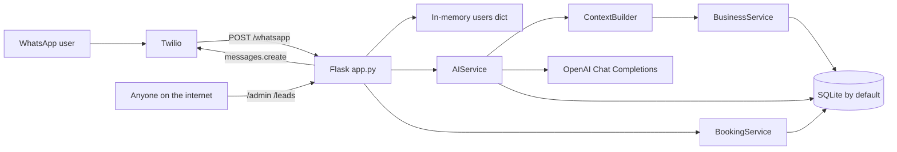
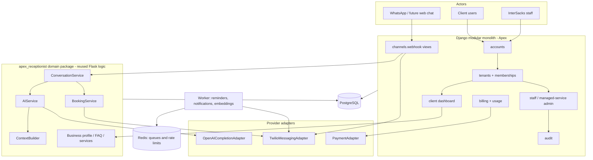
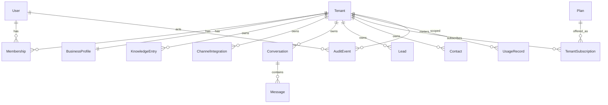

# Apex Phase 0 Architecture Audit

**Product:** InterSacks Digital AI receptionist, to be rebranded as **Apex by InterSacks Digital**  
**Audit type:** Read-only Phase 0 architecture, security, and hybrid-SaaS readiness review  
**Audit date:** 3 November 2026 (Africa/Johannesburg)  
**Canonical inspected ref:** `main` at `8d1c527866fc8388bd7831687445546c08839894`  
**Related unmerged work inspected without checkout:** draft PRs #2–#6 (Milestones 2–5)

**Classification used throughout**

| Label | Meaning |
| --- | --- |
| **Verified** | Observed in the checked-out `main` tree or via `git show` / GitHub metadata without changing files |
| **Unmerged** | Present on remote milestone branches / draft PRs, not on `main` |
| **Assumption** | Reasonable inference not proven by runtime execution |
| **Risk** | A plausible failure, security, or delivery issue |
| **Recommendation** | Proposed direction; not implemented in this audit |

This audit did **not** modify application code, configuration, tests, dependencies, or deployment files. The only permitted change is this report. No paid APIs were called. No secrets or customer records are reproduced here.

---

## 1. Executive summary

The current canonical codebase on `main` is a **single-process Flask WhatsApp receptionist**, not yet a hybrid SaaS platform. It already contains reusable building blocks: Twilio webhook handling, OpenAI-backed answers with tenant-shaped business context, SQLAlchemy models for `Business`, `Customer`, `Booking`, `Conversation`, `Service`, `FAQ`, and `KnowledgeDocument`, plus a JSON admin API for business profile, services, and FAQs.

It is **not production-safe for multiple clients**. On `main`:

- Every inbound WhatsApp message is attributed to the first `Business` row (`BusinessService.get_default_business()`).
- `/admin/*` and `/leads` are unauthenticated and expose or mutate business and personal data.
- Booking conversation state lives in an in-memory `users` dict and is lost on restart.
- Full customer phone numbers and message bodies are printed to stdout.
- There are no tests, no CI, no Docker/Gunicorn wiring, and no Django code.
- Documentation describes a keyword bot and `leads.json`, which the current Python code no longer uses.

A **complete rewrite is not justified**. The domain split is already useful: HTTP in `app.py` / `routes/`, persistence in `models/` + `database.py`, and behaviour in `services/`. That structure can evolve.

Critically, **later Flask platform work already exists and must be preserved**. Five draft PRs (September 2026, Africa/Johannesburg) stack Milestones 2–5 on branches that are **not merged to `main`**. The tip of that stack (`cursor/deployable-observable-operable-c503`) adds WhatsApp-number tenant routing, session login, CSRF, PostgreSQL/Alembic, a server-rendered dashboard, Redis/RQ jobs, Docker, Gunicorn, health endpoints, and a pytest suite the PR describes as 87 passed / 1 skipped. That work is the real receptionist core. `main` is an earlier snapshot.

**Recommended architecture:** do not stay on unauthenticated single-tenant Flask, and do not throw the receptionist away to start a greenfield Django app. Recover the unmerged Flask receptionist engine, extract it as a shared Python domain package, and grow a **Django modular monolith** around it for accounts, tenancy, managed-service administration, knowledge, usage, and billing. Django is the preferred management framework; PostgreSQL is the preferred database; Twilio and OpenAI remain behind provider adapters. Avoid microservices.

**Do not implement Phase 1 until this audit is reviewed and explicitly approved.**

---

## 2. Repository and environment facts

### 2.1 Git identity

| Item | Verified value |
| --- | --- |
| Remote | `https://github.com/lesleysacks/a.i-receptionist` |
| Visibility | Public |
| Default / current branch | `main` (this audit did not switch branches) |
| HEAD commit | `8d1c527866fc8388bd7831687445546c08839894` |
| HEAD message | `Implement Step 3: AI service with multi-tenant business context` |
| Author date | 22 July 2026, 21:23 SAST (Africa/Johannesburg) |
| Working tree | Clean; no uncommitted changes |
| Tracking | `main` matches `origin/main` |

`git log --all` shows additional commits that are **not on `main`**:

| Commit | Branch | Message |
| --- | --- | --- |
| `50c7148` | `origin/cursor/add-cloud-agent-environment-c503` | Add Cloud Agent development environment config |
| `63e7c54` | `origin/cursor/receptionist-core-mvp-c503` | Milestone 2: production-ready receptionist core |
| `418962c` | `origin/cursor/tenant-routing-auth-durable-state-c503` | Milestone 3: multi-tenant routing, admin auth, durable state |
| `a3eafdf` | `origin/cursor/production-data-layer-security-c503` | Milestone 4: production data layer, security hardening, live-readiness |
| `1a576dc` + `7ef7b8a` | `origin/cursor/deployable-observable-operable-c503` | Milestone 5 + docs |

Those branches correspond to **open draft PRs #2–#6**, stacked on each other, none merged. **Unrelated work that must be preserved:** this entire milestone stack, plus GitHub issue #1 (`TODO`: knowledge-base RAG, document uploads, embeddings, vector search, website widget).

### 2.2 Application structure on `main`

```
app.py                 Flask app, Twilio webhook, in-memory booking FSM, reminders, /leads
database.py            SQLAlchemy engine, create_all, SQLite column shim
models/                Business, Booking, Conversation, Customer, FAQ, KnowledgeDocument, Service
routes/admin.py        Unauthenticated JSON CRUD for the default business
services/
  ai_service.py        OpenAI JSON receptionist + conversation persistence
  booking_service.py   Booking create / list / reminders
  business_service.py  Tenant config, services, FAQs
  context_builder.py   Structured prompt context
businesses.json        Truncated, invalid JSON leftover (not read by Python)
leads.json             Empty array leftover (not read by Python)
README-SETUP.md        End-user setup guide (partially stale)
requirements.txt       Pinned Python dependencies
```

**Entry points (verified)**

| Entry | Behaviour |
| --- | --- |
| `python app.py` | Loads `.env`, requires Twilio SID/token, `init_database()`, starts APScheduler, Flask dev server on `0.0.0.0:$PORT` |
| Module import of `app.py` | Creates Flask app, Twilio client, validator, and DB tables; does **not** start the scheduler unless `__name__ == "__main__"` |
| WSGI / Gunicorn | `gunicorn` is pinned but **unused** on `main` (no `wsgi.py`) |

`app.py` begins with a UTF-8 BOM (`U+FEFF`). CPython still compiles it; some tooling does not.

### 2.3 Languages, frameworks, runtime

| Item | Verified |
| --- | --- |
| Language | Python (GitHub language stats: Python only) |
| Inspected runtime | Python 3.12.3 in this environment |
| Documented requirement | Python 3.8+ in `README-SETUP.md` |
| Web framework | Flask 3.1.3 |
| ORM | SQLAlchemy 2.0.41 (declarative mapped models) |
| Messaging | Twilio 9.10.2 |
| AI | openai 2.25.0; default model `gpt-4.1-mini` |
| Scheduler | APScheduler 3.11.2 |
| Env loading | python-dotenv 1.2.2 |
| Django | **Not present** on any inspected branch |
| Frontend | Inline HTML string for `/leads` on `main`; Jinja templates exist only on unmerged M4/M5 |

**Dependencies listed but not imported by `main` Python code (verified by source search):** `flask-cors`, `gunicorn`, `gspread`, `google-auth`, `google-auth-oauthlib`, `oauth2client`, `httplib2`, `PyJWT`, plus several Google/OAuth transitive packages. These look like leftovers from a Sheets-based or earlier design.

### 2.4 Deployment and hosting

On `main`:

- No `Dockerfile`, `docker-compose.yml`, `Procfile`, `render.yaml`, `fly.toml`, GitHub Actions, or hosting manifest.
- Production process is undocumented beyond `python app.py` and an ngrok-style Twilio webhook.
- Database default is `sqlite:///receptionist.db` via `DATABASE_URL`.
- `create_all()` runs on boot. There are no Alembic migrations on `main`.
- The scheduler that sends reminders only starts in the `__main__` block. A WSGI worker would accept webhooks **without** sending reminders.

**Unmerged M5** adds Docker (python:3.12-slim, non-root), Compose (app + PostgreSQL 16 + Redis 7 + RQ worker), Gunicorn (`wsgi:app`), Alembic, `/health` and `/ready`, JSON logs, optional Sentry, and GitHub Actions CI. That is the closest thing this repository has to a hosting architecture, but it is **not on `main`**.

### 2.5 Environment variable names

Names only. Values were not read from a live `.env` (no `.env` file is in the workspace). Example values in `README-SETUP.md` are treated as sensitive and are **not copied here**.

**Required to boot `main` (verified: `RuntimeError` if missing)**

- `TWILIO_ACCOUNT_SID`
- `TWILIO_AUTH_TOKEN`

**Used on `main`**

| Name | Role |
| --- | --- |
| `TWILIO_PHONE_NUMBER` | Outbound From number |
| `TWILIO_WHATSAPP_NUMBER` | Fallback if `TWILIO_PHONE_NUMBER` unset; code default is the Twilio sandbox number |
| `OWNER_PHONE_NUMBER` | Fallback owner notification destination |
| `OPENAI_API_KEY` | Required at AI-call time, not at boot |
| `OPENAI_MODEL` | Default `gpt-4.1-mini` |
| `DATABASE_URL` | Default `sqlite:///receptionist.db` |
| `LOG_LEVEL` | Default `INFO` |
| `PORT` | Default `5000` |
| `FLASK_DEBUG` | Default `false` |

**Additional names on unmerged M5 (not on `main`)**

`APP_ENV`, `SECRET_KEY` / `FLASK_SECRET_KEY`, `ADMIN_API_KEY`, `ADMIN_PASSWORD` (CLI only), `REDIS_URL`, `RQ_QUEUE`, `SENTRY_DSN`, `SENTRY_TRACES_SAMPLE_RATE`, `OPENAI_TIMEOUT`, `SESSION_COOKIE_SECURE`, `LOGIN_MAX_ATTEMPTS`, `LOGIN_WINDOW_SECONDS`, `LOGIN_LOCKOUT_SECONDS`, `DB_POOL_SIZE`, `DB_MAX_OVERFLOW`, `DB_POOL_TIMEOUT`, `DB_POOL_RECYCLE`, `GUNICORN_WORKERS`, `GUNICORN_THREADS`, `GUNICORN_TIMEOUT`, `GUNICORN_GRACEFUL_TIMEOUT`, `GUNICORN_WORKER_CLASS`, `LOG_FORMAT`.

### 2.6 Documentation, tests, CI

| Artefact | `main` | Unmerged M5 |
| --- | --- | --- |
| `README-SETUP.md` | Present; describes keyword matching, `leads.json`, no OpenAI/admin API | Still present |
| `README.md` | Missing | Present; architecture, env, Docker, CI |
| `AGENTS.md` | Missing | Present |
| Tests | **None** | `tests/` with 85 `test_*` functions; PR claims 87 passed, 1 skipped |
| CI | **None** | `.github/workflows/ci.yml` (PostgreSQL + Redis + pytest) |
| GitHub issue #1 | Open: RAG / uploads / widget | Not implemented there either |

`README-SETUP.md` is **stale relative to `main`**: it documents a keyword table (pricing, hours, location) that does not exist in current Python, says bookings are saved to `leads.json`, and includes credential-shaped example values in a public repository.

### 2.7 Uncommitted / unrelated work to preserve

- Working tree is clean; nothing local to stash.
- **Preserve** draft PRs #2–#6 and their branches. They are the bulk of the production receptionist design.
- **Preserve** issue #1 as the stated knowledge-base roadmap.
- Do not treat `businesses.json` / `leads.json` as live data stores; they are unused by Python. `businesses.json` is truncated and is not valid JSON. It also contains contact fields that should not be treated as documentation samples.

---

## 3. Existing functionality inventory

Status is for **canonical `main`** unless marked Unmerged. Runtime of live Twilio/OpenAI was not exercised.

| Feature | Status | Evidence | Notes |
| --- | --- | --- | --- |
| Flask health/home | Implemented and verified in code | `GET /` returns a static running message | Not a dependency-aware readiness check |
| WhatsApp inbound webhook | Implemented and verified in code | `POST /whatsapp` | Twilio signature required; TwiML reply |
| Twilio signature validation | Implemented and verified in code | `RequestValidator` + `X-Twilio-Signature` | Uses `request.url`; likely fragile behind TLS-terminating proxies (**Risk**) |
| Twilio outbound (owner notify) | Implemented and verified in code | `client.messages.create` in `notify_owner` | Failures are printed, not retried; booking still saved |
| Twilio outbound (reminders) | Partially implemented | `send_reminders` + APScheduler hourly | Only started from `python app.py`; naive local `datetime.now()` vs `utcnow` on rows; not tenant-aware |
| OpenAI Q&A | Implemented and verified in code | `AIService._ask_model` JSON chat completions | Requires `OPENAI_API_KEY` at call time; failures become a handoff message |
| Prompt construction | Implemented and verified in code | System instructions + `ContextBuilder` JSON + knowledge docs + last 15 messages | Model is instructed not to invent facts |
| Structured AI actions | Partially implemented | Actions parsed from JSON | Only `start_booking` has a backend effect. `handoff_human` and `get_*` do not call tools |
| Conversation message history | Implemented and verified in code | `Conversation` rows keyed by `business_id` + `customer_id` | Sliding window of 15 messages |
| Booking FSM | Partially implemented | In-memory `users[sender]` steps `ask_name` → `ask_date` → `ask_service` | No confirm step on `main`; state not durable; not tenant-scoped; lost on restart. **Unmerged M2+** adds confirm, cancel/restart, durable `ConversationState` |
| Business profile | Partially implemented | `Business` model + admin GET/PUT | Auto-created as `"Your Business"`; WhatsApp number not stored on `main` |
| Services catalogue | Implemented and verified in code | `Service` model + admin CRUD + context | Unique per `(business_id, name)` |
| FAQ knowledge | Implemented and verified in code | `FAQ` model + admin CRUD + context | Unique per `(business_id, question)` |
| Knowledge documents / RAG | Partially implemented | `KnowledgeDocument` model; full text dumped into the prompt | No upload API, no embeddings, no retrieval. Issue #1 still open |
| Lead capture | Partially implemented | Bookings persisted as `Booking` + `Customer` | No separate Lead entity; `leads.json` unused; `/leads` lists **all** bookings |
| Customer records | Implemented and verified in code | Unique `(business_id, phone)` | Name filled when booking |
| Multi-tenant data shapes | Partially implemented | FKs to `business_id` on child tables | Runtime still uses default business only |
| Admin configuration API | Partially implemented | `/admin/business`, `/services`, `/faq` | Validation for email/phone/duration; **no auth on `main`** |
| Admin UI | Missing on `main` | `/leads` is an unauthenticated HTML table | **Unmerged M4** adds login + dashboard |
| Human escalation | Partially implemented | `handoff_human` customer message | No ticket, no owner ping, no transcript handoff |
| Error handling | Partially implemented | AI exceptions → safe message; Twilio notify/remind try/except | Webhook has no top-level try/except; AI/DB failures can 500 |
| Retries | Missing on `main` | Notify/remind print and stop | **Unmerged M5** RQ retries (max 3) for notify/remind |
| Logging / monitoring | Partially implemented | stdlib logging for AI; `print` for PII-bearing webhook/leads | No request metrics, no Sentry on `main` |
| Website chat / voice / email channels | Missing | Flags exist on `Business` | No routes or adapters |
| Keyword FAQ bot described in README | Missing (replaced) | README table vs `AIService` | Docs drift |
| Deployment automation | Missing on `main` | — | Present unmerged on M5 |
| Tests | Missing on `main` | — | Present unmerged on M2–M5 |

### 3.1 Request handlers on `main`

| Method | Path | Auth | Purpose |
| --- | --- | --- | --- |
| GET | `/` | None | Liveness string |
| POST | `/whatsapp` | Twilio signature | Inbound WhatsApp |
| GET | `/leads` | **None** | HTML table of all bookings |
| GET/PUT | `/admin/business` | **None** | Default tenant profile |
| GET/POST | `/admin/services` | **None** | Service list/create |
| PUT/DELETE | `/admin/services/<id>` | **None** | Service update/delete |
| GET/POST | `/admin/faq` | **None** | FAQ list/create |
| PUT/DELETE | `/admin/faq/<id>` | **None** | FAQ update/delete |

### 3.2 Conversation behaviour on `main` (verified)

1. Inbound body/sender required; empty body → 400.
2. If sender is in the in-memory booking steps, the message is **not** sent to OpenAI; it is treated as name, date, or service.
3. Date parsing accepts several formats; date-only values default to 09:00. Past dates are **accepted** on `main`.
4. After service is collected, `BookingService.create_booking` writes the row and `notify_owner` fires immediately on the request thread.
5. Otherwise `AIService.respond` loads tenant context, knowledge documents, and history; asks the model for JSON `{action, message}`.
6. If `action == start_booking` and `booking_enabled`, the in-memory FSM starts at `ask_name`.

**Unmerged M2** changes this into an explicit service (`ConversationService`) with confirmation, cancel/restart, service matching, past-date rejection, and booking without OpenAI for clear booking intent.

---

## 4. Architecture and dependency assessment

### 4.1 Current architecture (`main`)



This is a **modular monolith in embryo**: routes, services, and models are separated, but the HTTP layer still owns the booking FSM, Twilio client, scheduler, and default-tenant resolution.

### 4.2 Strengths to reuse

- Service-layer boundary (`BusinessService`, `BookingService`, `AIService`, `ContextBuilder`) already hides SQLAlchemy from most route code.
- `business_id` is on every operational table; uniqueness is tenant-scoped for customers, services, and FAQs.
- AI output is constrained to JSON with an allow-list of actions; there is **no general tool-calling / code-execution loop**.
- OpenAI client is injectable (`AIService(client=...)`), which is a test seam (used heavily on unmerged branches).
- Twilio RequestValidator is already wired.
- Admin API serialization and field allow-lists (`BUSINESS_FIELDS`) are a good start for a later Django/DRF layer.
- Unmerged M2–M5 already extracted the FSM, added auth, PostgreSQL, jobs, and tests. That is the highest-value reuse in the git history.

### 4.3 Weaknesses

- Single default tenant at runtime.
- HTTP, FSM, notifications, and process lifecycle mixed in `app.py`.
- SQLite `create_all` is not a migration strategy; the conversation-column shim is SQLite-only.
- Naive datetimes (`datetime.utcnow` on models vs `datetime.now()` in reminders/FSM).
- Incomplete ORM cascades: services/FAQs cascade from `Business`; customers, bookings, conversations, and knowledge documents do not. Deleting a business would be unsafe.
- Unused Google Sheets / CORS / Gunicorn packages increase attack surface and confusion.
- No provider abstractions: Twilio and OpenAI are imported directly.
- Documentation and leftover JSON files describe a previous architecture.

### 4.4 Unmerged architecture (M5 tip)

```mermaid
flowchart TB
  WA[WhatsApp] --> TW[Twilio]
  TW -->|To number| WH[POST /whatsapp]
  WH --> ROUTE[BusinessService.get_by_whatsapp_number]
  ROUTE --> CONV[ConversationService]
  CONV --> AI[AIService]
  CONV --> BOOK[BookingService]
  CONV --> STATE[(conversation_states)]
  BOOK --> RQ[RQ jobs]
  RQ --> TW
  ADMINUI[Browser dashboard] --> AUTH[Session login + CSRF]
  AUTH --> DASH[Tenant-scoped CRUD]
  OPS[Operator] -->|X-Admin-Key + X-Business-Id| API[/admin JSON]
```

This is still Flask, still one process family, and already much closer to a managed multi-business receptionist than `main`. It is **not** yet a self-service SaaS (no registration, no plans, no per-tenant credentials, no Django).

---

## 5. Security and privacy findings

Findings below are **severity-ranked for canonical `main`**, with a note when unmerged M5 already remediates them. No secret values or customer message contents are included.

### 5.1 Findings table

| Finding | Severity | Evidence | Risk | Recommended remediation |
| --- | --- | --- | --- | --- |
| Unauthenticated admin JSON API can read and change the default business, services, and FAQs | **Critical** | `routes/admin.py` has no auth decorator; blueprint registered in `app.py` | Anyone who can reach the host can rebrand the bot, plant FAQs (prompt injection), or destroy catalogue data | Require session or operator credentials; derive tenant from principal. Unmerged M3 already does this |
| Unauthenticated `/leads` exposes names, phone numbers, appointment times, and services | **Critical** | `app.py` `view_leads`; `BookingService.list_bookings()` has no `business_id` filter | Direct POPIA personal-information disclosure; cross-client leakage once multiple businesses exist | Login + tenant-scoped query. Unmerged M3 scopes `/leads` |
| All conversations and bookings attributed to the first `Business` row | **High** | `current_business()` → `get_default_business()` | Data contamination; one client's customers and prompts mix with another's | Route by destination WhatsApp number; never fall back to another tenant. Unmerged M3 |
| Booking FSM is in-memory and keyed only by sender phone | **High** | `users = {}` in `app.py` | Lost bookings on restart; same phone talking to two businesses would collide | Durable `(business_id, sender)` state. Unmerged M3 `ConversationState` |
| Full WhatsApp identifiers and message bodies logged to stdout | **High** | `print(f"{sender}: {incoming_msg} -> {reply}")` and `print("NEW LEAD:", lead)` | PII in logs, hosting dashboards, and crash dumps; POPIA/operator over-collection | Structured logs with masked identifiers; never log bodies. Unmerged M5 masks senders |
| Public README contains credential-shaped Twilio examples | **High** | `README-SETUP.md` Configuration section | If those values were ever real, they are compromised in git history | Rotate any credentials that were ever used; replace examples with obvious placeholders; consider `git filter` only if confirmed real |
| `businesses.json` in git contains a personal email and phone and is truncated invalid JSON | **Medium** | File on `main`; Python never loads it | Unnecessary PII in a public repo; confusing dual source of truth | Remove from git or replace with a synthetic fixture; do not document it as live config |
| Twilio signature check uses Flask `request.url` | **Medium** | `is_valid_twilio_request()` | Behind TLS proxies, validation fails closed (outage) or, if someone disables it, fails open. Header-spoofed URL reconstruction can also fail open if untrusted | Reconstruct from a configured public base URL (`WEBHOOK_BASE_URL`), not from client-controlled Host headers. **Still present on M5** |
| No CSRF, no Flask `SECRET_KEY`, no session security | **Medium** | Flask app created with defaults | Any future cookie login on this code would be forgeable; `/leads` is currently unauthenticated so CSRF is secondary | Django or Flask-WTF as on M4; required `SECRET_KEY` in production |
| No rate limiting on webhook, admin, or AI calls | **Medium** | No limiter on `main` | SMS/AI cost abuse; booking spam; admin brute force once auth exists | Per-tenant and per-sender limits; login lockout. M5 limits **login only**, not WhatsApp/AI |
| Human handoff does not notify a human | **Medium** | `handoff_human` only changes the customer-visible message | Customers believe a person is coming; nobody is alerted | Create an escalation record + notify owner/staff |
| Knowledge documents are concatenated into the system prompt | **Medium** | `AIService._knowledge_documents` | Prompt injection, token cost, and cross-doc leakage within a tenant; no size cap | Retrieval with metadata filters; treat document text as untrusted data; cap tokens |
| SQLite default + `create_all` in any environment | **Medium** | `database.py` | Schema drift, no reviewable migrations, weak production durability | PostgreSQL + Alembic. Unmerged M4 |
| Reminders and owner SMS share one Twilio account and From number | **Medium** | Module-level `Client` and `TWILIO_PHONE_NUMBER` | Wrong sender identity in multi-tenant; blast-radius of one stolen token | Per-tenant messaging credentials encrypted at rest; provider adapter |
| Incomplete delete cascades / no `ON DELETE` on FKs | **Medium** | `models/business.py` relationships | Orphan PII or failed deletes; hard to honour deletion requests | Explicit `ondelete` policy per table; tenant purge job |
| No POPIA lawful-basis, retention, access, or deletion workflow | **Medium** | No models or routes for consent/retention | Unlawful retention of phone numbers and chat content | Retention schedule, export/delete APIs, operator audit |
| Unused Google Sheets / OAuth / CORS libraries | **Low** | `requirements.txt` vs imports | Extra CVEs and implied integrations that do not exist | Remove unused dependencies |
| UTF-8 BOM on `app.py` | **Low** | File starts with `EF BB BF` (also on M5) | Tooling/syntax surprises | Save as UTF-8 without BOM |
| `FLASK_DEBUG` can be enabled via env | **Low** | `app.run(debug=...)` | Werkzeug debugger in a reachable process | Ignore debug in production profile (M4 `APP_ENV`) |
| Dependency vulnerability scan not run | **Unknown** | Audit constraint: no installs | Unscanned pinned tree, including `oauth2client` (legacy) | After approval, `pip-audit` / GitHub Dependabot on a CI branch |

### 5.2 Authentication and authorisation (`main`)

**Verified:** there is none for humans. Twilio signatures protect only `/whatsapp`. There is no user model, password hash, session, role, or API key check.

**Unmerged:** `AdminUser` (email unique globally, one `business_id`, werkzeug password hash), session login, `login_required`, operator `ADMIN_API_KEY` with `X-Business-Id`, CSRF on browser forms.

Remaining gaps even on M5: no platform staff role distinct from a shared operator key; no object-level roles (owner vs receptionist vs read-only); no SSO; no customer identity beyond phone number.

### 5.3 Secret management

- `.gitignore` includes `.env` and `*.db` (**verified**).
- Secrets are read from the environment; they are not hard-coded in Python.
- `README-SETUP.md` still embeds example credential-shaped strings (**do not reuse; rotate if they were ever live**).
- No vault, KMS, or per-tenant secret table.
- Twilio auth token is used both as API credential and webhook HMAC key (Twilio's model); leaking it forges webhooks **and** sends messages.

### 5.4 Webhook signature verification

Implemented. Missing signature → 403. **Assumption:** this works on a local ngrok URL where Flask sees the same URL Twilio signed. **Risk:** production reverse proxies. Configure a canonical public webhook base URL rather than trusting `X-Forwarded-*` alone.

There is no Twilio `MessageSid` idempotency key; duplicate webhook deliveries can re-run the FSM and, on `main`, create duplicate bookings.

### 5.5 Input validation

Admin API validates JSON object shape, email/phone regex, positive booking duration, unique service/FAQ names, non-negative prices. WhatsApp body is only stripped. Dates are parsed but past dates are allowed on `main`. Names are unbounded except DB column sizes. AI messages are stored as raw text.

### 5.6 Prompt injection and tool execution

**Positive:** the model cannot execute arbitrary tools. Allowed actions are a closed enum; backend code decides what `start_booking` means.

**Risks:**

- User messages are placed in the chat as `role=user` after system context; a user can try to override instructions. Mitigation is instruction text only.
- Owner-controlled FAQs and knowledge documents are injected as trusted system context. A compromised or malicious FAQ is a stored prompt injection against that tenant (and, on `main`, against the only tenant).
- Unauthenticated admin API makes stored prompt injection trivial for an outsider.

### 5.7 POPIA considerations

Personal information processed (verified by fields): customer name, phone (WhatsApp identifier), appointment time, free-text service request, full chat content, owner phone, business contact fields.

Not found: privacy policy hook, consent language, purpose limitation, operator vs responsible-party record, access request workflow, deletion/retention, cross-border processing record, encryption-at-rest beyond whatever the host disk provides, separate production/staging data.

Logging of identifiers and bodies on `main` is a concrete POPIA over-collection issue.

South Africa is the likely operating geography (**assumption** from InterSacks / README examples). Confirm responsible party and operator agreements before onboarding real clients.

### 5.8 Tenant isolation readiness

Data model is **almost** ready; runtime is **not**. Isolation today is a coding convention (`where business_id == ...`) plus some unique constraints. There is no PostgreSQL row-level security, no request-scoped tenant, no tests on `main`. `list_bookings()` and `bookings_due_for_reminder()` are global.

---

## 6. Hybrid SaaS readiness matrix

Statuses: **Missing**, **Partial (`main`)**, **Partial (unmerged M5)**, **Present (unmerged M5)**. Complexity is the effort to reach Apex-grade behaviour from the best existing code (usually M5, not `main`).

### 6.1 Multi-tenancy

| Requirement | Current status | Reusable implementation | Missing | Complexity | Dependencies / risks |
| --- | --- | --- | --- | --- | --- |
| Multiple businesses on one platform | Partial (`main` model only); Present (M5 routing) | `Business` table; M5 `whatsapp_number` + `get_by_whatsapp_number` | Self-service tenant provisioning; shared vs dedicated numbers | Medium | Unique WhatsApp number assumes one number per tenant; shared short-code routing needs extra identity |
| Tenant-specific profiles and AI instructions | Partial | `Business` fields + `ContextBuilder` + FAQs/services | Dedicated instruction / tone / guardrail objects; locale-quality control | Medium | Prompt size and injection |
| Isolated conversations, leads, contacts, knowledge | Partial (`main` FKs, default tenant); Present (M5 queries + tests) | `business_id` FKs; M5 isolation tests | RLS; purge; Lead entity; knowledge upload isolation | Medium | One missed filter is a cross-tenant incident |
| Tenant-specific integrations and credentials | Missing | Single env Twilio/OpenAI | Encrypted `ChannelIntegration` secrets; per-tenant OpenAI project/keys optional | High | Secret storage, rotation, Twilio subaccounts |
| Tenant usage limits and billing records | Missing | AI token log fields exist only as log lines | `UsageRecord`, quotas, hard stops | Medium | Must meter before paid plans |

### 6.2 Self-service

| Requirement | Current status | Reusable implementation | Missing | Complexity | Dependencies / risks |
| --- | --- | --- | --- | --- | --- |
| Client registration and authentication | Missing on `main`; Partial (M5 CLI-created admins) | M5 `AuthService`, hashed passwords, login UI | Sign-up, email verify, password reset, invitations, MFA | Medium | Django contrib.auth is a better long-term home |
| Business configuration dashboard | Missing on `main`; Present (M5 Jinja dashboard) | M5 services/FAQ/business forms | Apex branding, website widget config, channel setup wizard | Medium | Do not keep two dashboards (Flask + Django) long term |
| Knowledge-base management | Partial | FAQ CRUD; `KnowledgeDocument` model | Upload, parsing, chunking, retrieval UI | High | Issue #1; file malware; token cost |
| Channel configuration | Partial | Feature flags on `Business`; M5 WhatsApp number field | Voice, email, web chat, Twilio console automation | High | Provider APIs; number provisioning |
| Conversation and lead management | Partial | Booking list; conversation rows | Inbox UI, search, assignment, lead stages, export | Medium | PII access controls |
| Usage and subscription visibility | Missing | Token counts logged, not stored | Customer-facing usage, invoices, plan limits | High | Billing provider + metering |

### 6.3 Managed service

| Requirement | Current status | Reusable implementation | Missing | Complexity | Dependencies / risks |
| --- | --- | --- | --- | --- | --- |
| InterSacks administrative dashboard | Missing | M5 operator API key can act as any tenant | First-class staff users, impersonation with banner, global tenant list | Medium | Must not reuse one shared API key as the staff model |
| Client onboarding and configuration assistance | Partial | `manage.py` on M5; admin API | Onboarding checklist, number purchase, prompt QA, go-live | Medium | Operational, not just code |
| Support and maintenance workflows | Missing | Handoff action string; owner SMS on booking | Tickets, conversation replay, replay tools, status page | Medium | — |
| Manage client settings with permissions | Partial (M5 session vs operator key) | Tenant scoping from principal | Roles: platform_admin, success_manager, tenant_owner, tenant_staff | Medium | Audit every impersonation |
| Audit trail for administrative actions | Missing | M5 logs operator API use (no table) | `AuditEvent` with actor, tenant, diff, IP | Medium | Retention of audit vs PII |

### 6.4 Commercial readiness

| Requirement | Current status | Reusable implementation | Missing | Complexity | Dependencies / risks |
| --- | --- | --- | --- | --- | --- |
| Subscription plan architecture | Missing | — | `Plan`, features, limits | Medium | Product decision |
| Usage metering for AI and messaging | Missing | OpenAI usage on the response object is logged | Persist tokens, Twilio segments, per-channel counts | Medium | Clock skew; failed calls still cost money |
| Cost attribution per tenant | Missing | `business_id` on conversations | Cost table, FX, margin | Medium | Provider price changes |
| Onboarding fees and recurring billing | Missing | — | Invoice items, proration | High | Accounting |
| Payment provider integration | Missing | No Stripe/Paystack/PayPal references in git | Adapter + webhooks + dunning | High | Choose SA-friendly provider (assumption: Paystack/Stripe) |

---

## 7. Recommended target architecture

### 7.1 Options considered

| Option | Verdict |
| --- | --- |
| 1. Remain Flask and evolve into a multi-tenant platform | **Reject as the long-term management platform.** Flask M5 is an excellent receptionist engine, but Apex needs first-class users, permissions, admin, billing, and a junior-maintainable SaaS structure. Rebuilding all of that in Flask duplicates Django. |
| 2. Incrementally integrate Flask with Django | **Adopt as the transition.** Keep the M5 receptionist running; introduce Django for identity, tenancy, dashboards, and billing; share PostgreSQL and a domain package. Time-box the dual stack so juniors are not maintaining two HTTP frameworks indefinitely. |
| 3. Migrate to a Django modular monolith, preserving Flask business logic | **Adopt as the target.** Django hosts HTTP (dashboard, APIs, webhook views). Existing services (`AIService`, `ConversationService`, `BookingService`, `ContextBuilder`, provider adapters) become a plain Python package. |

A greenfield rewrite of the receptionist is **unsuitable**: conversation behaviour, Twilio validation, OpenAI JSON protocol, and (on M5) 80+ tests would be thrown away to re-litigate solved problems.

Microservices are **not** justified. Scale, team size, and domain boundaries do not require independent deployable services. Redis/RQ as a **worker** is an implementation detail inside one system, not a microservice architecture.

### 7.2 Target shape

One Django project, several apps, one PostgreSQL database, one background worker, provider adapters at the edges.



**Tenant isolation contract (from day one of Phase 1 implementation):**

1. Every business row has a stable `tenant_id` (UUID) plus integer PK if needed.
2. Every operational table has a non-nullable `tenant_id` / `business_id` FK.
3. Application queries always include that FK; staff impersonation writes an audit row first.
4. Channel routing never falls back to “the default business”.
5. Secrets are per-tenant and never logged.

**Junior-maintainable rules:** one repo, one Django project, domain package without Flask imports, adapters with fakes in tests, no shared mutable globals, no `get_default_business()` on customer paths.

### 7.3 Why Django for the management plane

- Built-in authentication, password hashing, reset flows, permissions, and admin — replacing M5's thin `AdminUser` rather than growing it.
- ORM + migrations that the team will use for SaaS entities (plans, audit, memberships) anyway.
- Clear app boundaries: `accounts`, `tenants`, `receptionist`, `knowledge`, `billing`.
- South African / POPIA-friendly features (custom user, audit, deletion) are ordinary Django work.

The Flask HTTP layer (`app.py`, Jinja dashboard) should be **retired after** Django views call the same domain services, not before.

### 7.4 Provider abstractions

| Port | First adapter | Fake for tests |
| --- | --- | --- |
| Messaging | Twilio WhatsApp | Records outbound messages in memory |
| Voice (later) | Twilio Voice | Same port, different adapter |
| AI completion | OpenAI JSON receptionist | Fixture JSON |
| Embeddings (later) | OpenAI embeddings | Hash-stub |
| Payments (later) | Paystack or Stripe | Webhook fixtures |
| Jobs | Django-RQ or Celery | Eager mode |

Do not leak Twilio or OpenAI types into Django views.

---

## 8. Proposed data model

Not created in the database. This is a design proposal for PostgreSQL / Django. Tenant ownership is mandatory unless noted.

### 8.1 Entity overview



### 8.2 Models

| Model | Purpose | Important fields | Relationships | Tenant ownership | Sensitive data |
| --- | --- | --- | --- | --- | --- |
| **User** | Login identity for clients and InterSacks staff | `id` (UUID), `email` unique, `password` hash, `is_active`, `is_staff`, `mfa_enabled`, `last_login` | Memberships; audit actor | No (global identity) | Email, password hash, MFA secrets |
| **Tenant** | One client business / billing account | `id` (UUID), `slug` unique, `name`, `status` (trial/active/suspended), `timezone`, `created_at` | Profile, memberships, all operational data | Self | Name may be commercially sensitive |
| **Membership** | Role of a user on a tenant | `role` (`owner`, `admin`, `staff`, `viewer`), `invited_by`, `created_at` | User, Tenant | Yes | — |
| **StaffAccess** (optional) | InterSacks managed-service grant | `role` (`platform_admin`, `success`), `reason`, `expires_at` | User, Tenant | Yes | Enables impersonation; audit required |
| **BusinessProfile** | Receptionist-facing profile | `display_name`, `industry`, `description`, `language`, `opening_hours`, `tone`, `system_instructions`, `booking_enabled`, `booking_duration`, contact fields, channel flags | Tenant 1:1 | Yes | Owner phone, address |
| **KnowledgeEntry** | Owner-maintained facts | `kind` (faq/document/chunk), `title`, `body`, `source_filename`, `embedding_ref`, `active` | Tenant | Yes | May contain client policies and personal data if misused |
| **Contact** | End-customer of a tenant (today: WhatsApp user) | `phone`, `email`, `name`, `whatsapp_id`, `consent_at`, `retention_until` | Tenant; unique `(tenant, phone)` | Yes | **POPIA primary record** |
| **Conversation** | Thread per contact/channel | `channel`, `status`, `handoff_state`, `external_thread_id` | Tenant, Contact | Yes | Metadata |
| **Message** | One inbound/outbound turn | `role`, `direction`, `body`, `provider_message_id`, `tokens_in/out`, `created_at` | Conversation, Tenant (denormalised FK) | Yes | **Chat content is PII** |
| **Lead** | Commercial follow-up (bookings can create leads) | `stage`, `source`, `notes`, `appointment_at`, `service_requested` | Tenant, Contact, optional Booking | Yes | Name, phone, intent |
| **Booking** | Appointment request | `appointment_at`, `service`, `status`, `reminder_sent_at`, `owner_notified_at` | Tenant, Contact | Yes | Same as today |
| **ChannelIntegration** | Per-tenant provider config | `channel` (whatsapp/voice/web/email), `provider`, `external_number`, `status`, `credentials_ref` | Tenant; unique number globally where required | Yes | **Provider tokens**; encrypt at rest; never log |
| **Plan** | Commercial product | `code`, `name`, `monthly_price`, `included_messages`, `included_tokens`, `max_mailboxes` | Subscriptions | No (catalogue) | Pricing |
| **TenantSubscription** | Current commercial state | `status`, `started_at`, `current_period_end`, `onboarding_fee_cents`, `provider_customer_id` | Tenant, Plan | Yes | Billing identifiers |
| **UsageRecord** | Metered consumption | `meter` (ai_tokens, whatsapp_outbound, voice_minutes), `quantity`, `period_start`, `cost_estimate` | Tenant | Yes | Indirect PII if too granular; aggregate where possible |
| **AuditEvent** | Who did what | `actor_user_id`, `actor_kind` (user/staff/system), `action`, `object_type`, `object_id`, `before/after` (redacted), `ip`, `created_at` | Tenant nullable for platform-level events | Usually yes | IP addresses; must not store secrets or full message bodies |

**Reuse mapping from current SQLAlchemy models**

| Current | Target |
| --- | --- |
| `Business` | Split into `Tenant` + `BusinessProfile` + later `ChannelIntegration.whatsapp_number` |
| `AdminUser` (M5) | `User` + `Membership` (do not keep email unique-to-one-business if staff can belong to none or many) |
| `Customer` | `Contact` |
| `Conversation` (per message) | `Message`; add parent `Conversation` |
| `ConversationState` (M5) | Column/JSON on `Conversation` or small `ConversationState` table |
| `Booking` | `Booking` + optional `Lead` |
| `FAQ` / `KnowledgeDocument` / `Service` | `KnowledgeEntry` and a `Service` catalogue table (keep `Service` distinct; it is operational, not just knowledge) |
| — | New: Plan, TenantSubscription, UsageRecord, AuditEvent, ChannelIntegration |

**Sensitive-data rules**

- Encrypt `ChannelIntegration` credentials.
- Mask phones in logs (`***1234`).
- Default retention for Messages/Contacts (proposed: 12 months after last inbound, configurable per tenant).
- Hard-delete vs anonymise: Contacts and Messages should be deletable on request; AuditEvents retain that a deletion occurred without the original body.
- Do not put PAN/payment details in Apex; leave them with the payment provider.

---

## 9. Testing and quality assessment

### 9.1 Existing tests on `main`

**None.** No `tests/`, `pytest.ini`, or CI workflow. `pytest` is not in `main`'s `requirements.txt`.

**Safe execution:** tests were **not** run. Running the app would create `receptionist.db` (a filesystem change) and requires Twilio env vars. Installing pytest would change the environment. Live OpenAI/Twilio calls are forbidden by this audit. There is therefore **no test result to report for `main`**.

### 9.2 Unmerged test estate (M5, not executed here)

PR #6 reports **87 passed, 1 skipped** (live OpenAI test skipped without a key). This audit did not re-run them (would require checkout and dependency install). The test names on that branch cover:

- Webhook signature accept/reject
- Booking happy path, validation, cancel/restart, idempotent confirm
- AI success/failure/timeout/missing key
- Tenant isolation of services, context, bookings, routing, leads
- Auth, CSRF, login rate limit, Redis limiter fallback
- Dashboard CRUD isolation
- Migrations, PostgreSQL URL pooling, health/readiness, jobs

**Gaps even on M5**

| Area | Gap |
| --- | --- |
| Conversation behaviour | Little coverage of prompt-injection / FAQ poisoning; no multilingual tests |
| Webhook validation | No proxy URL / `WEBHOOK_BASE_URL` cases; no `MessageSid` replay |
| Tenant isolation | No PostgreSQL RLS tests; knowledge documents not isolation-tested as an upload path (no upload path) |
| AuthZ | No staff impersonation; no multi-membership |
| Usage limits | None |
| Privacy | No retention/deletion tests; log-redaction not asserted on `main` and only partially on M5 |
| Billing | None |
| Channels | WhatsApp only |
| Load / cost | No token-budget tests |

### 9.3 Recommended testing strategy

| Layer | What | Rule |
| --- | --- | --- |
| Unit | Validators, FSM transitions, context builder, action parsing, adapters | No network; fake OpenAI/Twilio |
| Integration | Django ORM isolation, webhook view → domain → DB, migrations | PostgreSQL in CI |
| Security | AuthZ matrix, CSRF, webhook signatures, tenant IDOR cases, prompt-injection fixtures | Must fail CI on cross-tenant read |
| Privacy | Masked logs, delete/export, retention job | Use synthetic PII only |
| Contract | Provider adapter fakes vs recorded fixtures | Do not call paid APIs in default CI |
| E2E | One Docker-compose path: login, set FAQ, simulated webhook, lead appears | Twilio request signed with test token |
| Load (later) | Token and message quotas | Staging only |

Default CI must not require `OPENAI_API_KEY` or live Twilio. Optional nightly live smoke is a separate job.

---

## 10. Phased migration and implementation roadmap

Do not start these phases until this audit is approved. Each phase should leave the receptionist able to answer WhatsApp and take a booking.

| Phase | Goal | Preserve | Outcome |
| --- | --- | --- | --- |
| **0** | This audit | Entire git history including draft PRs | Shared understanding |
| **1** | Receptionist core recovery + Django foundation | M2–M5 behaviour and tests; Twilio/OpenAI seams | Apex branch with M5 engine + Django project skeleton + tenant/user models; `main` not deployed as-is |
| **2** | Domain extraction | Conversation/AI/booking services | Package `apex_receptionist` with no Flask imports; webhook still works |
| **3** | Django management plane | M5 dashboard features | Client login, memberships, staff admin, CSRF/auth in Django; Flask UI removed |
| **4** | Channels and knowledge | FAQ/service CRUD | ChannelIntegration secrets; document upload + retrieval (issue #1, scoped) |
| **5** | Commercial | Usage logs | Plans, metering, payment adapter, quotas |
| **6** | Hardening | All of the above | POPIA deletion/export, audit completeness, retire Flask HTTP, dependabot, load tests |

**Explicitly out of Phase 1:** billing, RAG/embeddings, website widget, voice, self-service public sign-up, microservices, rewriting the FSM in Django models first.

---

## 11. Risks, dependencies, and unresolved questions

### 11.1 Risks

| Risk | Severity | Comment |
| --- | --- | --- |
| Deploying current `main` to real customers | Critical | Unauthenticated PII dashboard and admin API |
| Losing unmerged M2–M5 draft PRs | High | They contain the production receptionist |
| Dual Flask+Django stack lasting more than one or two phases | High | Junior maintenance hazard |
| Shared Twilio account for all tenants | High | Cost, branding, blast radius |
| Prompt injection via FAQs/docs | High | Worse if admin API stays open |
| POPIA exposure from logs and unbounded retention | High | Legal, not only technical |
| Public repo + stale credential examples | High | Rotation required if real |
| Naive timezones (SAST vs UTC) | Medium | Wrong reminder windows |
| OpenAI/Twilio cost without quotas | Medium | Especially on a public webhook |
| Stacked draft PRs drift from `main` | Medium | Rebase will be needed |

### 11.2 Dependencies

- Product: plan names, included usage, managed-service vs self-service packaging, onboarding fee.
- Legal: POPIA responsible-party wording, operator agreement, WhatsApp consent text, retention period.
- Twilio: whether InterSacks holds one account and maps numbers, or each client brings a subaccount.
- AI: whether `gpt-4.1-mini` remains the default; budget per tenant.
- Payments: Stripe vs Paystack vs EFT invoicing for managed clients.
- Hosting: M5 assumes Docker + PostgreSQL + Redis; production host not chosen on `main`.
- Issue #1 RAG: vector store choice (pgvector vs external).

### 11.3 Unresolved questions

1. Is any production instance currently running from `main`? (Not verifiable from the repo.)
2. Were README example Twilio values ever live? If yes, rotate immediately.
3. Should InterSacks staff use the same login system as clients?
4. One WhatsApp number per tenant, or a single Apex number with a business PIN / keyword?
5. Are bookings legally appointments or only lead requests? (Copy currently says a consultant will contact the customer.)
6. Currency default is `USD` in the model while README examples are ZAR — which is the product default?
7. Will the public GitHub repository remain public after Apex branding and client data models land?
8. Confirm whether draft PRs #2–#6 were accepted in review but never merged, or were paused.

---

## 12. Explicit Phase 1 implementation recommendation

**Stop after this audit. Do not implement Phase 1 until approved.**

### 12.1 Phase 1 intent

Make Apex **safe to build on** without changing receptionist behaviour except where `main` is unsafe. Recover the unmerged engine. Put Django in place for tenancy and identity. Do not ship billing, RAG, or a rewrite.

### 12.2 Phase 1 scope (recommended)

1. **Preserve git history.** Rebase or merge the stacked draft PRs (#2–#6) onto a dedicated Apex branch from current `main`. Do not discard M5 tests, Docker, or conversation FSM.
2. **Security freeze on canonical `main`.** Do not deploy `main` as-is. If anything is already public, take `/admin` and `/leads` off the internet immediately (even a host-level basic auth is an emergency wrap, not the real fix).
3. **Secret hygiene.** Replace credential-shaped README examples with placeholders; rotate any credentials that might have been real; drop or synthesise `businesses.json` contact fields.
4. **Scaffold Django** in the same repo (`config`, apps `accounts`, `tenants`, `audit`) with PostgreSQL. Do not move the WhatsApp webhook in Phase 1 unless it is a thin Django view calling existing `ConversationService`.
5. **Introduce User / Tenant / Membership / AuditEvent** per section 8, migrating `Business` → tenant+profile and M5 `AdminUser` → user+membership. Keep `business_id` compatibility.
6. **Keep Twilio and OpenAI behind the existing services**; add a thin adapter interface only if it does not change behaviour.
7. **Fix remaining M5 security nits that affect go-live:** canonical webhook URL, UTF-8 BOM, reminder timezone policy, MessageSid idempotency.
8. **CI on the Apex branch:** pytest (existing) + Django system checks + a tenant-isolation regression that fails if `get_default_business()` is used on a customer path.
9. **Documentation:** replace stale keyword-bot instructions with the actual AI+booking flow; document env var names only.

### 12.3 Phase 1 non-goals

- Rewriting the receptionist in Django models/views from scratch
- Self-service public registration and payments
- Vector RAG / PDF pipeline (schedule as Phase 4; issue #1)
- Voice, email, or website widget
- Microservices
- Deleting Flask domain code

### 12.4 Suggested Phase 1 acceptance criteria

- WhatsApp booking and Q&A still work in mocked tests (M5 suite green).
- Unauthenticated `/admin` and `/leads` no longer exist.
- Two tenants cannot see each other's leads or FAQs.
- Django can create a tenant, a user, and a membership without breaking the webhook.
- No new paid API calls in CI.
- This report remains the baseline; subsequent phases update it rather than silently diverging.

### 12.5 Immediate operational advice (not implementation)

Until Phase 1 is approved and landed, treat `main` as a **lab snapshot**, treat draft PR #6 as the **receptionist baseline**, and treat Apex as a **Django-centred SaaS** that wraps that baseline rather than replacing it.

---

## Appendix A — Evidence index (paths on `main`)

| Path | Role |
| --- | --- |
| `app.py` | Webhook, FSM, leads UI, reminders, Twilio client |
| `database.py` | Engine, `create_all`, SQLite shim |
| `models/*.py` | Tenant-shaped schema |
| `routes/admin.py` | Unauthenticated JSON admin |
| `services/ai_service.py` | OpenAI JSON receptionist |
| `services/booking_service.py` | Bookings; unscoped list/reminders |
| `services/business_service.py` | Default tenant + catalogue |
| `services/context_builder.py` | Prompt context |
| `requirements.txt` | Pinned deps including unused Google/Sheets/CORS/Gunicorn |
| `README-SETUP.md` | Stale setup + sensitive-looking examples |
| `businesses.json` / `leads.json` | Unused leftovers |

Unmerged tip: `origin/cursor/deployable-observable-operable-c503` (`7ef7b8a`).

## Appendix B — Draft PRs that must not be lost

| PR | Title | Branch | State |
| --- | --- | --- | --- |
| #2 | Add Cloud Agent development environment | `cursor/add-cloud-agent-environment-c503` | Draft, open, base `main` |
| #3 | Milestone 2: Production-ready AI Receptionist core | `cursor/receptionist-core-mvp-c503` | Draft, open |
| #4 | Milestone 3: Multi-tenant routing, authentication & durable conversation state | `cursor/tenant-routing-auth-durable-state-c503` | Draft, open |
| #5 | Milestone 4: Production data layer, security hardening & live-integration readiness | `cursor/production-data-layer-security-c503` | Draft, open |
| #6 | Milestone 5: Deployable, observable & operable AI Receptionist | `cursor/deployable-observable-operable-c503` | Draft, open |

## Appendix C — Audit constraints (compliance)

- No application files modified except this document.
- No branch checkout of milestone code; inspection used `git show` / `git ls-tree` / GitHub read APIs.
- No dependency installation, no `.env` value disclosure, no live Twilio/OpenAI calls, no database created.

**Phase 0 complete. Awaiting explicit approval before Phase 1.**
